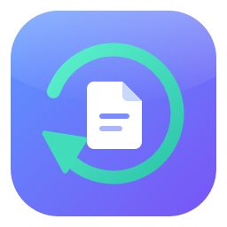
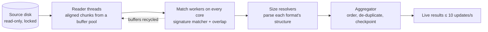

<div align="center">



# Fast File Recovery

**Get deleted files back, fast. One program, nothing written to the disk you're saving.**

[](#installing-updating-and-uninstalling)
[](#installing-updating-and-uninstalling)
[](#installing-updating-and-uninstalling)
[](https://github.com/Akulav/fast-file-recovery/releases/latest)
[](https://github.com/Akulav/fast-file-recovery/actions/workflows/ci.yml)

[Download](https://github.com/Akulav/fast-file-recovery/releases/latest) · [Quick start](#quick-start) · [Features](#features) · [Building](#building-from-source) · [Changelog](CHANGELOG.md)

</div>

## Contents

- [Why it's different](#why-its-different)
- [Features](#features)
- [Quick start](#quick-start)
- [What you need](#what-you-need)
- [Installing, updating and uninstalling](#installing-updating-and-uninstalling)
- [Command line](#command-line)
- [How it works](#how-it-works)
- [Supported file types](#supported-file-types)
- [Settings](#settings)
- [Safety and privacy](#safety-and-privacy)
- [Building from source](#building-from-source)
- [Versions and releases](#versions-and-releases)
- [Tests](#tests)
- [Project layout](#project-layout)
- [Troubleshooting](#troubleshooting)
- [License](#license)

## Why it's different

- **Never writes to your disk.** The source is opened read-only, and the code has no way to write to it. Recovered files must go to a *different* physical disk, and the app enforces that.
- **Locks the disk.** While it scans, the operating system can't write to the disk or reuse the space your deleted files are in.
- **Uses every core.** Reading runs at the disk's full sequential speed, and signature matching runs on every CPU core.
- **One file per OS.** A single download installs the app and later updates it. No DMG, MSI or zip.
- **Keeps itself current.** It checks GitHub for new releases, verifies each download with SHA-256, and installs nothing until you click Update.

## Features

| Area | What you get |
|---|---|
| Sources | Every physical disk with model, size, bus and partitions; click one partition to scan only that. Disk image files (`.img`, `.dd`, `.raw`, `.bin`, `.iso`) work like disks. |
| Quick scan | Reads NTFS `$MFT`, FAT12/16/32 and exFAT records of deleted files. Keeps original names, folders and timestamps, and exact extents (fragmented NTFS files too). |
| Deep scan | Signature carving over the whole disk: works on formatted, RAW and damaged disks and on any file system (ext4, APFS, HFS+ …). Over 45 format families. |
| Results & preview | Live results while scanning, grouped by category and type. Virtual table that handles millions of rows. Filters, search, sorting, image thumbnails, text and hex preview. |
| Recovery | Checks the destination first (different disk, free space, writable). Layouts: by type, original paths, or flat. Writes a CSV and JSON report with BLAKE3 hashes. |
| Disk images | Copy a failing drive to an image file on another disk, skipping bad sectors, then scan the copy without further wear. |
| Updates | One-click verified updates on all three OSes. |
| Comfort | Pause, resume and checkpoints (resume after a crash or reboot), dark and light themes, keyboard shortcuts. |

## Quick start

1. **Download** the file for your OS from the [latest release](https://github.com/Akulav/fast-file-recovery/releases/latest).
2. **Start it.** Windows asks for administrator rights; Linux and macOS offer a "Restart with administrator rights" button.
3. **Pick a disk** (or open a disk image) and press **Start scan**. *Full* (Quick, then Deep) is the default.
4. **Select the files** you want and **recover them to another disk**.

> **Tip: stop using the disk now.** Every new write can overwrite deleted data. Don't install anything on it, and don't recover files back onto it.

## What you need

| | Minimum | Comfortable |
|---|---|---|
| OS | Windows 10 x64, Ubuntu 22.04 (glibc 2.35) or equivalent, macOS 12 on Apple Silicon | Windows 11, a current Linux, macOS 14+ |
| CPU | 2 cores | 8 cores (matching scales with cores) |
| RAM | 2 GB | 8 GB+ (results use about 50 bytes per found file) |
| Disks | A second disk (USB is fine) for the recovered files | A fast SSD as the destination |

## Installing, updating and uninstalling

| OS | File | First start |
|---|---|---|
| Windows 10/11 x64 | `FastFileRecovery-setup.exe` | Per-user installer: Start menu shortcut, optional desktop shortcut. No admin rights needed to install. |
| Linux x64 | `fast-file-recovery-linux-x64` | `chmod +x` it and run it. It offers "Install for this user" (`~/.local/share/fast-file-recovery`, a `~/.local/bin` link, a menu entry and icons) or "Just run it". |
| macOS Apple Silicon | `fast-file-recovery-macos-arm64` | Offers to install `~/Applications/Fast File Recovery.app`. First open of a downloaded file: right-click → Open, or `xattr -d com.apple.quarantine fast-file-recovery-macos-arm64`. |

**Updating.** The app checks GitHub 20 seconds after start and every 6 hours (you can turn this off), or when you press *Check for updates* in About. *Update* downloads the file for your OS, checks it against `SHA256SUMS.txt`, then applies it: the Windows setup runs silently in update mode, while Linux and macOS swap the binary in place. Updates never run during a scan or recovery. An update replaces the program only and never touches settings, saved scans or logs.

**Uninstalling.** Windows: *Settings → Apps*. The uninstaller asks whether to delete settings and saved scans (default No). Linux/macOS: `fast-file-recovery --uninstall` (add `--delete-data` to remove settings, saved scans and logs too).

## Command line

| Flag | Meaning |
|---|---|
| `--version` | Print the version and exit |
| `--here` | Run without installing or asking to install |
| `--uninstall [--delete-data]` | Remove the installed copy (and optionally its data) |

## How it works



**Quick scan** reads the file system's own records of deleted files. It is fast and keeps names and folders, but it only works while those records survive. **Deep scan** reads every sector and recognises files by their content (magic bytes), then parses each format to find where the file ends. It finds files on formatted or damaged disks, but names come out generated (`jpg_1f400_640x480.jpg`). **Full** runs both and shows each file only once.

## Supported file types

| Category | Formats |
|---|---|
| Images | JPEG, PNG, GIF, BMP, TIFF / DNG / CR2 / NEF / ARW, WebP, HEIC / AVIF / CR3, PSD / PSB, ICO |
| Video | MP4 / MOV / M4V / 3GP, AVI, MKV / WebM, FLV, MPEG-TS, WMV / ASF |
| Audio | MP3 (ID3 and untagged), WAV, FLAC, OGG / Opus, M4A, AAC (ADTS), AIFF, MIDI |
| Documents | PDF, DOCX / XLSX / PPTX / ODT / ODS / ODP / EPUB (ZIP), DOC / XLS / PPT / MSG (OLE), RTF; XML and HTML are off by default (noisy) |
| Archives | ZIP / JAR / APK, RAR 4 / 5, 7z, GZIP, BZIP2, XZ, TAR, ISO, CAB |
| Other | SQLite, Windows EXE / DLL, ELF, Mach-O, PST / OST, KeePass KDBX, VMDK, VHD, VHDX, TTF / OTF, WOFF / WOFF2; EML is off by default |

## Settings

| Group | Settings |
|---|---|
| Appearance | Dark, Light, Follow system |
| Scanning | Default mode, chunk size (4–64 MiB), queue depth (0 = auto), retries on read errors, only cluster-aligned starts |
| Formats | Every format with a checkbox; presets *Photos & videos*, *Documents*, *Everything* |
| Recovery | Folder layout, what to do with files that hit unreadable sectors, restore timestamps |
| Updates | Check automatically |
| Advanced | Open log folder, reset settings |

Settings live in `%APPDATA%\FastFileRecovery\` (Windows), `~/.config/fast-file-recovery/` (Linux) or `~/Library/Application Support/FastFileRecovery/` (macOS).

## Safety and privacy

- **Read-only by design.** Source handles are opened read-only, and the type that reads the disk has no write method (a compile-fail test guards this).
- **Locking.** Windows locks and dismounts the disk's volumes, Linux sets the block devices read-only (`BLKROSET`), macOS unmounts the disk. Locks are released on every exit path, including errors and cancel.
- **Destination check.** Recovery to the disk you are recovering from is refused. There is no override.
- **No telemetry.** The network is used only to check GitHub for updates.

## Building from source

Requirements: the Rust stable toolchain. On Windows you also need MSVC Build Tools and Inno Setup 6 (only for the installer).

```bash
cargo run --release -p ffr-app -- --here
```

On Windows, `run.bat` does it all (installing missing tools with winget): `run.bat` (release + setup + launch), `run.bat quick`, `run.bat dev`, `run.bat setup`, `run.bat clean`.

Linux needs: `libxkbcommon-dev libwayland-dev libx11-dev libxcursor-dev libxrandr-dev libxi-dev libgl1-mesa-dev`.

Build tasks are Rust too (`cargo xtask …`): `dist` (this OS's release file in `dist/`), `icons`, `installer-images`, `samples`, `bump`, `release`, `check`.

## Versions and releases

The version lives in the root `Cargo.toml`. Every change ships as a release:

1. Add bullets under `## [Unreleased]` in `CHANGELOG.md`.
2. `cargo xtask bump patch|minor|major`.
3. Commit, then push to `main`. CI tests on all three OSes, builds the three files, writes `SHA256SUMS.txt`, tags `vX.Y.Z` and publishes the release. A version with a hyphen (`0.2.0-beta.1`) becomes a pre-release.

`cargo xtask release --no-push` runs the pre-push checks without pushing.

## Tests

```bash
cargo test --workspace
```

```bash
cargo test -p ffr-core --release -- --ignored
```

```bash
cargo bench -p ffr-core
```

The first command runs the unit tests, one test per sample file (`crates/ffr-core/tests/samples`, each ≤ 50 KiB, generated by `cargo xtask samples`), and FAT16/FAT32 delete-and-recover fixtures. The second runs the slow 512 MiB synthetic-disk round trip: every sample at aligned, unaligned and chunk-crossing offsets plus one truncated, all checked by length and BLAKE3, with no duplicates allowed. The third runs the match-stage benchmark.

## Project layout

```
crates/ffr-core   engine: devices, I/O, scanning, signatures, carving, file systems, recovery
crates/ffr-app    the app: screens, widgets, theme, updater, self-install
crates/xtask      build tasks
assets/           master icon, generated icons, fonts, UI icons
installer/        Inno Setup script and wizard images
```

## Troubleshooting

| Problem | What to do |
|---|---|
| "Access denied" / disks show *Needs admin* | Start with administrator rights (Windows asks automatically; on Linux/macOS use *Restart with administrator rights*). Disk images work without them. |
| Can't lock the system disk | The OS is running from it, so it can't be locked. Stop using the computer while scanning, or connect the disk to another computer. |
| macOS: "can't be opened" on first start | Right-click → Open, or `xattr -d com.apple.quarantine <file>`. Give the app Full Disk Access in System Settings → Privacy & Security. Internal sealed system volumes on Apple Silicon can't be read raw. |
| Slow USB disk | USB 2 ports and hubs limit speed. Use a direct USB 3 port. Spinning USB disks are read with one sequential reader on purpose. |
| Many bad sectors | Stop and use **Create disk image…** to copy the disk once (bad areas are zero-filled and listed in `.ffrmap`), then scan the image. |

## License

[MIT](LICENSE). Fonts: Inter and JetBrains Mono (SIL OFL). UI icons follow Lucide (ISC).

<div align="center"><b>Made by Akulav</b></div>
