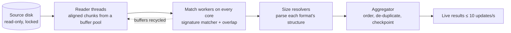

<div align="center">


# Fast File Recovery

**Get deleted files back, fast. Made by Akulav.**

Nothing is ever written to the disk you're saving. No spyware. No telemetry. One file per system that installs and updates itself.

[](https://github.com/Akulav/fast-file-recovery/releases/latest)
[](https://github.com/Akulav/fast-file-recovery/releases)
[](https://github.com/Akulav/fast-file-recovery/actions/workflows/build.yml)


### [⬇ Download the latest release](https://github.com/Akulav/fast-file-recovery/releases/latest)

</div>

---

## ⬇️ Download

One file per system. The same file installs the app the first time and updates it later.

| Platform | File | Notes |
| :-- | :-- | :-- |
| 🪟 **Windows 10 / 11** (x64) | [`FastFileRecovery-setup.exe`](https://github.com/Akulav/fast-file-recovery/releases/latest/download/FastFileRecovery-setup.exe) | Asks where to install. The app asks for administrator rights when it starts (raw disk access). |
| 🐧 **Linux** (x64) | [`fast-file-recovery-linux-x64`](https://github.com/Akulav/fast-file-recovery/releases/latest/download/fast-file-recovery-linux-x64) | glibc 2.28+, X11 or Wayland |
| 🍎 **macOS** (Apple Silicon) | [`fast-file-recovery-macos-arm64`](https://github.com/Akulav/fast-file-recovery/releases/latest/download/fast-file-recovery-macos-arm64) | macOS 12+ |

Every release also ships `SHA256SUMS.txt` so you can verify your download.

> ⚠️ **Stop using the disk now.** Every new write can overwrite deleted data. Don't install anything on it, and don't
> recover files back onto it.

## ✨ Features

<table>
<tr>
<td width="50%" valign="top">

### 🛡️ Safe by design
- **Never writes to your disk.** The source is opened read-only; the code has no way to write to it.
- **Locks the disk** while it scans, so the OS can't write to it or reuse the space your files are in.
- Recovered files must go to a **different physical disk**, and the app enforces that.

</td>
<td width="50%" valign="top">

### 🔍 Finds everything
- **Quick scan** reads NTFS, FAT12/16/32 and exFAT records of deleted files: original names, folders, timestamps.
- **Deep scan** recognises **45+ format families** by content, on formatted, RAW and damaged disks and any file system.
- **Full** (default) runs both and shows each file once.

</td>
</tr>
<tr>
<td width="50%" valign="top">

### ⚡ Fast & light
- Reads at the disk's full sequential speed; matching runs on **every CPU core**.
- Live results while scanning, in a table that handles millions of rows.
- A single native binary written in Rust. No .NET, no Electron.

</td>
<td width="50%" valign="top">

### 🔄 Always up to date
- **You choose the install folder** once; the app and everything it saves live there.
- **One-click updates** from GitHub, verified with SHA-256, into the same folder.
- Pause, resume and checkpoints; disk images for failing drives; dark and light themes.

</td>
</tr>
</table>

## 🚀 Getting started

### Windows
1. Download **`FastFileRecovery-setup.exe`** and run it.
2. Pick the install folder (default `%LOCALAPPDATA%\Programs\FastFileRecovery`, any folder you can write to works,
   e.g. `D:\Apps\FastFileRecovery`). It adds Start-menu and (optional) Desktop shortcuts and an entry in
   *Settings → Apps*.
3. Updates install into the same folder without asking: in-app with one click, or by running a newer setup.

Uninstall from *Settings → Apps*. The uninstaller asks whether to keep your settings, saved scans and logs.

### Linux
```bash
chmod +x fast-file-recovery-linux-x64
./fast-file-recovery-linux-x64
```
It asks for an install folder (default `~/.local/share/fast-file-recovery`), copies itself there and adds an app-menu
entry with icons and a `fast-file-recovery` terminal command. *Just run it* skips installing.
Running a newer download later offers to update the installed copy in its folder. Raw disks need root: the app offers
*Restart with administrator rights* (polkit). Uninstall with `fast-file-recovery --uninstall`.

### macOS (Apple Silicon)
```bash
chmod +x fast-file-recovery-macos-arm64
xattr -d com.apple.quarantine fast-file-recovery-macos-arm64
./fast-file-recovery-macos-arm64
```
It asks for an install folder (default `~/Applications/Fast File Recovery`) and creates `Fast File Recovery.app` there.
Give it Full Disk Access in *System Settings → Privacy & Security* to read disks.

### Recovering files
1. **Pick a disk** (or open a disk image) and press **Start scan**.
2. **Select the files** you want; preview images, text and hex while the scan runs.
3. **Recover them to another disk.** A CSV and JSON report with BLAKE3 hashes is written next to them.

> 💡 Want it portable? Put an empty `portable.txt` next to the program (or start it with `--portable`): it then keeps
> its data next to itself and never offers to install.

## 📁 Where your data lives

**In the install folder you chose**, next to the program. Nothing goes to `%APPDATA%`, `~/.config` or other system
folders. The folder is remembered (Windows: by the setup; Linux/macOS: in `~/.config/fast-file-recovery/install-dir`
or `~/Library/Application Support/FastFileRecovery/install-dir`), so updates keep everything in place. Settings and
saved scans from versions before 0.1.3 are moved in on the first start, also when the install folder is on another
drive.

| Path | Contents |
| :-- | :-- |
| `settings.toml` | settings (including window size and position) |
| `sessions/` | saved and resumable scans |
| `logs/` | daily log files (the last 7 are kept) |
| `update/` | a downloaded update while it is being applied |
| `.ffr-install` | marks the install folder (holds the installed version) |

Recovered files and disk images go wherever you choose, always on a disk other than the one being recovered.
Set `FFR_DATA_DIR` to use a different data folder.

## 🖥️ Command line

| Flag | Meaning |
| :-- | :-- |
| `--version` | Print the version and exit |
| `--here` | Run without offering to install (Linux/macOS) |
| `--portable` | Keep data next to the program, never install |
| `--uninstall [--delete-data]` | Remove the installed app, and with `--delete-data` its settings, saved scans and logs (Windows: starts the uninstaller) |

## 📄 Supported file types

| Category | Formats |
| :-- | :-- |
| Images | JPEG, PNG, GIF, BMP, TIFF / DNG / CR2 / NEF / ARW, WebP, HEIC / AVIF / CR3, PSD / PSB, ICO |
| Video | MP4 / MOV / M4V / 3GP, AVI, MKV / WebM, FLV, MPEG-TS, WMV / ASF |
| Audio | MP3 (ID3 and untagged), WAV, FLAC, OGG / Opus, M4A, AAC (ADTS), AIFF, MIDI |
| Documents | PDF, DOCX / XLSX / PPTX / ODT / ODS / ODP / EPUB (ZIP), DOC / XLS / PPT / MSG (OLE), RTF; XML and HTML are off by default (noisy) |
| Archives | ZIP / JAR / APK, RAR 4 / 5, 7z, GZIP, BZIP2, XZ, TAR, ISO, CAB |
| Other | SQLite, Windows EXE / DLL, ELF, Mach-O, PST / OST, KeePass KDBX, VMDK, VHD, VHDX, TTF / OTF, WOFF / WOFF2; EML is off by default |

## 🧯 Troubleshooting

| Problem | What to do |
| :-- | :-- |
| "Access denied" / disks show *Needs admin* | Start with administrator rights (Windows asks automatically; on Linux/macOS use *Restart with administrator rights*). Disk images work without them. |
| Can't lock the system disk | The OS is running from it, so it can't be locked. Stop using the computer while scanning, or connect the disk to another computer. |
| macOS: "can't be opened" on first start | Right-click → Open, or `xattr -d com.apple.quarantine <file>`. Internal sealed system volumes on Apple Silicon can't be read raw. |
| Slow USB disk | USB 2 ports and hubs limit speed. Use a direct USB 3 port. Spinning USB disks are read with one sequential reader on purpose. |
| Many bad sectors | Stop and use **Create disk image…** to copy the disk once (bad areas are zero-filled and listed in `.ffrmap`), then scan the image. |

<details>
<summary><b>🛠️ For maintainers: how it works, updates and releases</b></summary>

### How it works



**Quick scan** reads the file system's own records of deleted files: fast, keeps names and folders, but only while those
records survive. **Deep scan** reads every sector, recognises files by their magic bytes, then parses each format to
find where the file ends; names come out generated (`jpg_1f400_640x480.jpg`). **Full** runs both and shows each file once.
Locking: Windows locks and dismounts the disk's volumes, Linux sets the block devices read-only (`BLKROSET`), macOS
unmounts the disk; locks are released on every exit path.

### Publishing a release

Releases are fully automated by [`.github/workflows/build.yml`](.github/workflows/build.yml):

1. Add bullets under `## [Unreleased]` in [`CHANGELOG.md`](CHANGELOG.md), then `cargo xtask bump patch|minor|major`
   (updates `Cargo.toml`, `Cargo.lock` and the changelog heading).
2. Push to `main`.
3. If no release with that version exists, CI checks formatting and Clippy, tests and builds all three systems, tags the
   commit `vX.Y.Z` and publishes a GitHub release with exactly three programs, `FastFileRecovery-setup.exe`,
   `fast-file-recovery-linux-x64` and `fast-file-recovery-macos-arm64`, plus `SHA256SUMS.txt`. The notes come from the
   changelog. A version with a hyphen (`0.2.0-beta.1`) becomes a pre-release.
4. Installed copies find the release on GitHub by themselves (20 seconds after start and every 6 hours, or with
   *Check for updates* in About).

### How updates are applied

*Update* downloads this system's file into the install folder (`update/`), checks it against `SHA256SUMS.txt`, then

- **Windows:** runs `FastFileRecovery-setup.exe /VERYSILENT /UPDATE` with the current install folder. The setup closes the
  app, installs into the same folder and starts the new version.
- **Linux / macOS:** swaps the binary in the install folder in place (re-signing the app on macOS) and restarts.

Updates never run during a scan or recovery, never in the elevated copy, and never in local builds (only CI sets
`FFR_RELEASE_BUILD=1`).

### Building from source

```bash
cargo run --release -p ffr-app -- --here
```

On Windows, `run.bat` does it all (installing missing tools with winget): `run.bat` (release + setup + launch),
`run.bat quick`, `run.bat dev`, `run.bat setup`, `run.bat clean`. The Windows setup needs [Inno Setup 6](https://jrsoftware.org/isinfo.php):

```bash
iscc /DAppVersion=0.1.3 /DSourceExe=%CD%\target\release\fast-file-recovery.exe installer\ffr.iss
```

It writes `dist\FastFileRecovery-setup.exe`. For a Linux binary that runs on older distros:
`pip install ziglang && cargo install cargo-zigbuild`, then
`cargo zigbuild --release -p ffr-app --target x86_64-unknown-linux-gnu.2.28`.
Build tasks are Rust too (`cargo xtask …`): `dist`, `icons`, `installer-images`, `samples`, `bump`, `release`, `check`.
Debug builds never offer to install themselves (pass `--here` to a release build for the same).

### Tests

```bash
cargo test --workspace
```

```bash
cargo test -p ffr-core --release -- --ignored
```

The first runs the unit tests, one test per sample file (`crates/ffr-core/tests/samples`) and FAT16/FAT32
delete-and-recover fixtures. The second runs the slow 512 MiB synthetic-disk round trip. `cargo bench -p ffr-core`
runs the match-stage benchmark.

### Project layout

```
crates/ffr-core   engine: devices, I/O, scanning, signatures, carving, file systems, recovery
crates/ffr-app    the app: screens, widgets, theme, updater, self-install
crates/xtask      build tasks
assets/           master icon, generated icons, fonts, UI icons
installer/        Inno Setup script and wizard images
```

</details>

## 🙏 Credits

UI icons following [Lucide](https://lucide.dev) (ISC). Inter and JetBrains Mono fonts (SIL OFL 1.1, see `assets/fonts`).

---

<div align="center">

**Made with ❤️ by [Akulav](https://github.com/Akulav)**

<sub>© 2026 Akulav. Source-available under the <a href="LICENSE">Akulav Source-Available License</a>.</sub>

</div>
